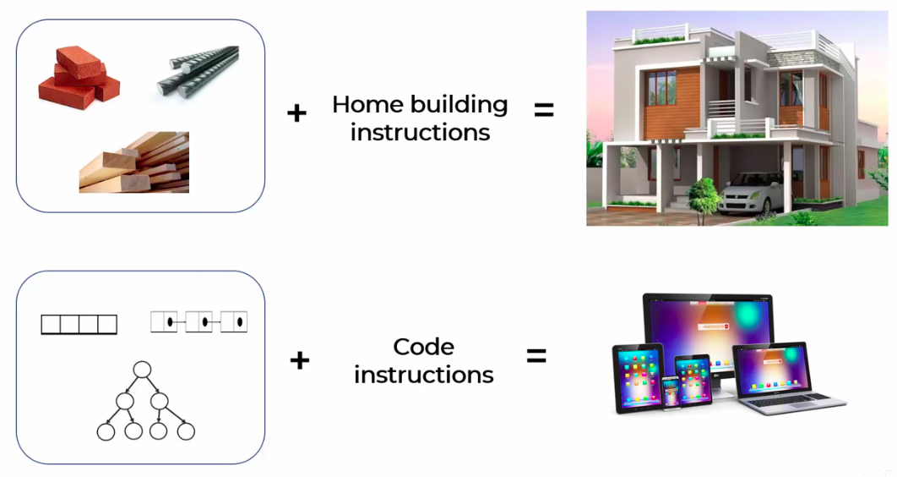
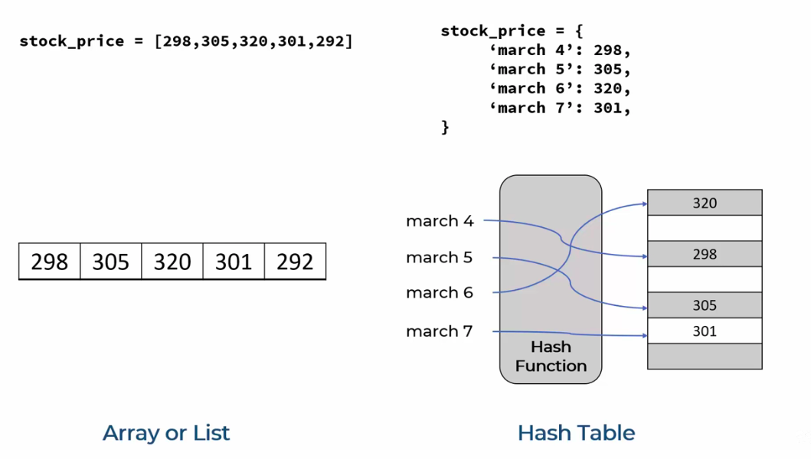

# Data structures
### - Data structures manage how data is stored and accessed
### - Data Structures in Python are ways to store, organize, and manage data efficiently so that it can be accessed, modified, and processed easily.

### - Data Structures decide how data is arranged in memory and how we work with it.



### - Data structures are building blocks or raw material for any software programs

### - One can't become a good programmer without sound understanding of data structures


```py
# List (Array)

price_list_array = [298, 305, 320, 301, 292]
print("List Examples")
for i, price in enumerate(price_list_array, start=1):
    print(f"Day{i}: {price}")

print("\n")

# Dictionary (Hash Table)

price_list_dict = {
    'march 4': 298,
    'march 5': 305,
    'march 6': 320,
    'march 7': 301,
    'march 8': 292
}

print("Dictionary Example:")
for data, price in price_list_dict.items():
    print(f"{data}: {price}")

# Output
List Examples
Day1: 298
Day2: 305
Day3: 320
Day4: 301
Day5: 292


Dictionary Example:
march 4: 298
march 5: 305
march 6: 320
march 7: 301
march 8: 292
```
---
### Linked List is not available in Python
### Big O notation is used to measure how running time or space requirements for your program grow as input size grows

