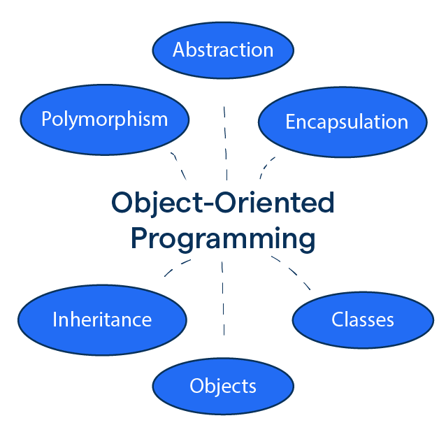

# OOP Notes

# What is OOP?

**OOP** stands for **Object-Oriented Programming**.

Python is an object-oriented language, allowing you to structure your code using **classes** and **objects** for better organization and reusability.

---

# Advantages of OOP

- Provides a clear structure to programs
- Makes code easier to maintain, reuse, and debug
- Helps keep your code DRY (**Don't Repeat Yourself**)
- Allows you to build reusable applications with less code

**Tip:** The DRY principle means you should avoid writing the same code more than once. Move repeated code into functions or classes and reuse it.

---

# What are Classes and Objects?

Classes and objects are the two core concepts in object-oriented programming.

A class defines what an object should look like, and an object is created based on that class. For example:

| Class | Objects |
| --- | --- |
| Fruit | Apple, Banana, Mango |
| Car | Volvo, Audi, Toyota |

When you create an object from a class, it inherits all the variables and functions defined inside that class.
---

### Resources for Python OOP:

- [geeksforgeeks](https://www.geeksforgeeks.org/python/python-oops-concepts/)
- [realpython](https://realpython.com/python3-object-oriented-programming/)
- [datacamp](https://www.datacamp.com/tutorial/python-oop-tutorial)
- [kinsta](https://kinsta.com/blog/python-object-oriented-programming/)

---

#### - Without the __init__() method, you would need to set properties manually for each object
#### - In Python, the pass statement is a placeholder, It does nothing, but it allows the code to run without errors when a statement is syntactically required

#### - pass keeps it syntactically valid

#### - self refers to the current object being created, It allows each object to have its own copy of the variables

#### - Use self to access class properties

- Python automatically passes the object as the first argument, but without self, your method doesn’t accept it.

<br>

### - this is true format

```python
    self.name = name
    self.age = age
    self.city = city
    self.country = country
```

#### - self Does Not Have to Be Named "self"
#### - It does not have to be named self, you can call it whatever you like, but it has to be the first parameter of any method in the class:

```python
    class Person:
        def __init__(myobject, name, age): # myobject (Python self Parameter)
            myobject.name = name
            myobject.age = age

  def greet(abc):
    print("Hello, my name is " + abc.name)

p1 = Person("Emil", 36)
p1.greet()
```

#### In Python, <code> __str__</code> is a special method (a “dunder method”) that defines how an object should be represented as a string—that is

#### It tells Python what to print when you do:

#### Without __str__, printing the object gives something like:
---
