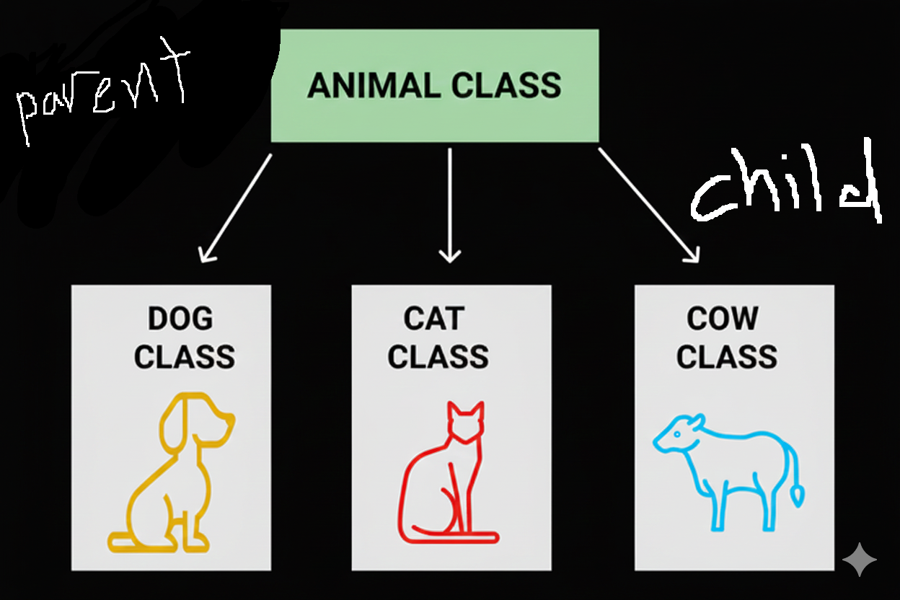
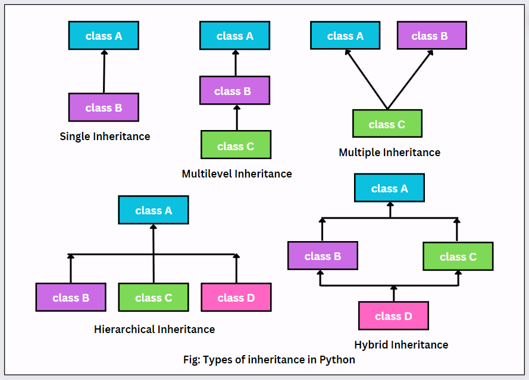

# Inheritance
### allows a class (child class) to acquire properties and methods of another class (parent class). It supports hierarchical classification and promotes code reuse.
---

## Types of Inheritance

### 1. Single Inheritance: A child class inherits from a single parent class.
### 2. Multiple Inheritance: A child class inherits from more than one parent class.
### 3. Multilevel Inheritance: A child class inherits from a parent class, which in turn inherits from another class.

### 4. Hierarchical Inheritance: Multiple child classes inherit from a single parent class.

### 5. Hybrid Inheritance: A combination of two or more types of inheritance.



---
### Single Inheritance
```py
# Syntax for a Single Inheritance

class ParentClass:
  # ParentClass attributes and methods

class ChildClass(ParentClass):
  # ChildClass attributes and methods
```

```py
# Single Inheritance

class Animal:
    def speak(self):
      print("Animal Speaks")

class Dog(Animal):
    def bark(self):
      print("Dog barks")

dog = Dog()

dog.speak()
dog.bark()
```
---

### Multilevel Inheritance
```py
# Syntax for a Multilevel Inheritance

class GrandParentClass:
  # Grandparent attributes and methods

class ParentClass(GrandParentClass):
  # Parent attributes and methods

class ChildClass(ParentClass):
  # Child attributes and methods
```

```py
# Multilevel Inheritance

class Grandparent:
  def greet(self):
    print("Hello from Grandparent")

class Parent(Grandparent):
  def talk(self):
    print("Parent Talks")

class Child(Parent):
    def Play(self):
      print("Child Play")
  
general_varible = Child()
parents = Parent()

general_varible.greet()
general_varible.talk()
general_varible.Play()

parents.greet()
parents.talk()
```
---

### Multiple Inheritance
```py
# Syntax for a Multiple Inheritance

class ParentClass1:
    # ParentClass1 attributes and methods

class ParentClass2:
    # ParentClass2 attributes and methods

class ChildClass(ParentClass1, ParentClass2):
    # ChildClass attributes and methods
```

```py
# Multiple Inheritance

class A:
  def method_A(self):
      print("Method A from class A")

class B:
  def method_B(self):
      print("Method B from class B")

class C(A, B):
  def method_C(self):
      print("Method C from class C")

c = C()

c.method_A()
c.method_B()
c.method_C()
```

### Hierarchical Inheritance
```py
# Syntax for a Hierarchical Inheritance

class ParentClass:
    # ParentClass attributes and methods

class ChildClass1(ParentClass):
    # ChildClass1 attributes and methods

class ChildClass2(ParentClass):
    # ChildClass2 attributes and methods
    
class ChildClass3(ParentClass):
    # ChildClass2 attributes and methods
```
```py
# Hierarchical Inheritance

class Vehicle:
  def start_engine(self):
      print("Engine started")

class Car(Vehicle):
  def drive(self):
      print("Car is driving")

class Bike(Vehicle):
    def ride(self):
      print("Car is driving")

car = Car()
bike = Bike()

car.start_engine()
car.start_engine()

car.drive()
bike.ride()
```

### Hybrid Inheritance
```py
# Syntax of Hybrid Inheritance

class ParentClass1:
    # ParentClass1 attributes and methods.

class ChildClass1(ParentClass1):
    # ChildClass1 attributes and methods.

class ChildClass2(ParentClass1):
    # ChildClass2 attributes and methods.

class ChildClass3(ParentClass1, ParentClass2):
    # ChildClass3 attributes and methods.
```

```py
# Hybrid Inheritance

class A:
  def m1(self):
    print("m1 in class A")

class B(A):
  def m2(self):
    print("m2 in class B")

class C(A):
  def m3(self):
    print("m2 in class C")

class D(B, C):
  def m4(self):
    print("m2 in class D")

d = D()

d.m1()
d.m2()
d.m3()
d.m4()
```