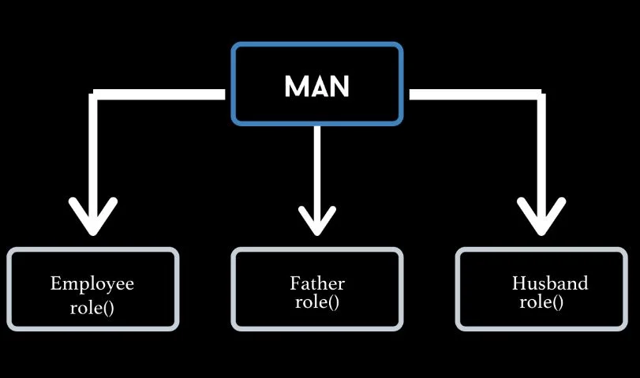
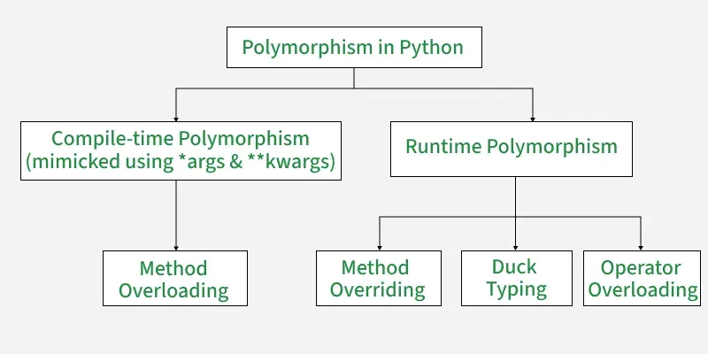
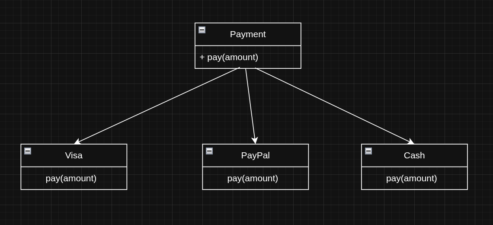

# Polymorphism

### Polymorphism in Python means "same operation, different behavior." It allows functions or methods with the same name to work differently depending on the type of object they are acting upon.



---

## Types of Polymorphism

---
# 1. Compile-Time Polymorphism:

## This type of polymorphism is determined during the compilation of the program. It allows methods or operators with the same name to behave differently based on their input parameters or usage. In languages like Java or C++, compile-time polymorphism is achieved through method overloading but it's not directly supported in Python.

### In Python:
### - True compile-time polymorphism is not supported.
### - Instead, Python mimics it using default arguments or (*args / **kwargs)
### - Operator overloading can also be seen as part of polymorphism, though it is implemented at runtime in Python.
---
```py
class Calculator:
    def add(self, *args):
        return sum(args)

calc = Calculator()
print(calc.add(5, 10))       # Two arguments
print(calc.add(5, 10, 15))   # Three arguments
print(calc.add(1, 2, 3, 4))  # Any number of arguments
```
### - *args means:
### - The method can accept 0 or more arguments.
### - All arguments are stored as a tuple.
### - allows passing multiple numbers.
### - *args allows flexible number of inputs.
---
# 2. Run-Time Polymorphism
## Run-Time Polymorphism is determined during the execution of the program. It covers multiple forms in Python:

### - Method Overriding: A subclass redefines a method from its parent class.
### - Duck Typing: If an object implements the required method, it works regardless of its type.
### - Operator Overloading: Special methods (__add__, __sub__, etc.) redefine how operators behave for user-defined objects.

```py
# Method Overriding
# We start with a base class and then a subclass that "overrides" the speak method.
class Animal:
    def speak(self):
        return "I am an animal."

class Dog(Animal):
    def speak(self):
        return "Woof!"

print(Dog().speak())

# 2 Duck Typing
class Cat:
    def speak(self):
        return "Meow!"

def make_animal_speak(animal):
    # This function works for both Dog and Cat because they both have a 'speak' method.
    return animal.speak()

print(make_animal_speak(Cat()))
print(make_animal_speak(Dog()))

# 3 Operator Overloading
# We create a simple class that customizes the '+' operator.
class Vector:
    def __init__(self, x, y):
        self.x = x
        self.y = y

    def __add__(self, other):
        # This special method defines the behavior of the '+' operator.
        return Vector(self.x + other.x, self.y + other.y)

    def __repr__(self):
        return f"Vector({self.x}, {self.y})"

v1 = Vector(2, 3)
v2 = Vector(4, 5)
v3 = v1 + v2

print(v3)
```
---
| Concept                  | Meaning                                       | Example                                  |
| ------------------------ | --------------------------------------------- | ---------------------------------------- |
| **Method Overriding**    | Child class replaces parent method            | Dog overrides `speak()`                  |
| **Duck Typing**          | Type doesn't matter; method existence matters | Function accepts anything with `speak()` |
| **Operator Overloading** | Custom behavior for `+`, `-`, `*`, etc.       | Adding two `Vector` objects              |
---
# 1. Polymorphism Using Method Overriding
### A child class overrides (changes) a method from the parent class.
```py
class Animal:
    def speak(self):
        return "Animal sound"

class Dog(Animal):
    def speak(self):
        return "Woof!"

class Cat(Animal):
    def speak(self):
        return "Meow!"
        
animals = [Dog(), Cat(), Animal()]

for animal in animals:
    print(animal.speak())
"""
Output

Woof!
Meow!
Animal sound

Same method name (speak) — different behavior.
"""
```
---
# 2. Polymorphism With Functions (Duck Typing)
### Python follows Duck Typing: “If it walks like a duck and quacks like a duck — it’s a duck.” , Anything that has a speak() method can be used, even if classes are unrelated.

```py
class Dog:
    def speak(self):
        return "Woof!"

class Cat:
    def speak(self):
        return "Meow!"

class Robot:
    def speak(self):
        return "Beep!"

def make_sound(obj):
    print(obj.speak())  # No matter what the object is!

make_sound(Dog())
make_sound(Cat())
make_sound(Robot())

"""
Output

Woof!
Meow!
Beep!

Python only cares that the object has the method, not about its class.
"""
```

---
# Real-Life Example: Payment System Using Polymorphism
```py
class Payment:
    def pay(self, amount):
        raise NotImplementedError("Subclass must implement this method")

class Visa(Payment):
    def pay(self, amount):
        return f"Paid ${amount} using Visa Card."

class PayPal(Payment):
    def pay(self, amount):
        return f"Paid ${amount} via PayPal account."

class Cash(Payment):
    def pay(self, amount):
        return f"Paid ${amount} in cash."

# Polymorphism in Action

payments = [Visa(), PayPal(), Cash()]

for method in payments:
    print(method.pay(100))

"""
Output

Paid $100 using Visa Card.
Paid $100 via PayPal account.
Paid $100 in cash.
"""    
```

## Why this is REAL-LIFE Polymorphism?
Because in apps like:

- Amazon
- Jumia
- Noon
- Any eCommerce system

The app doesn't care which payment method is used.

It just calls:
```py
payment.pay(amount)
```
And each payment method knows how to process the payment in its own way.

